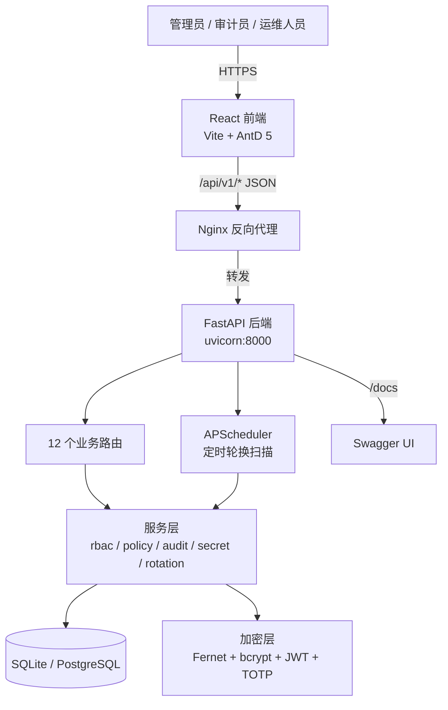
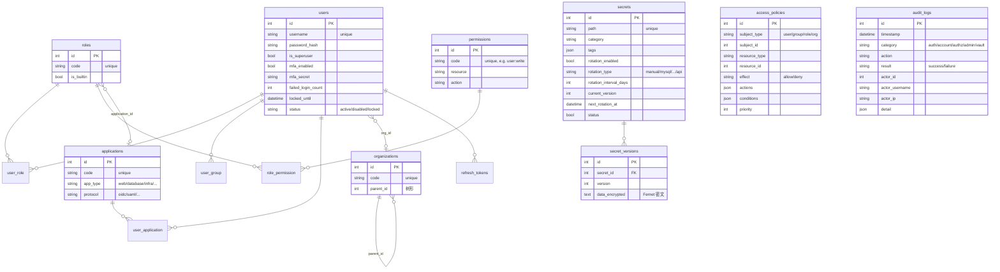
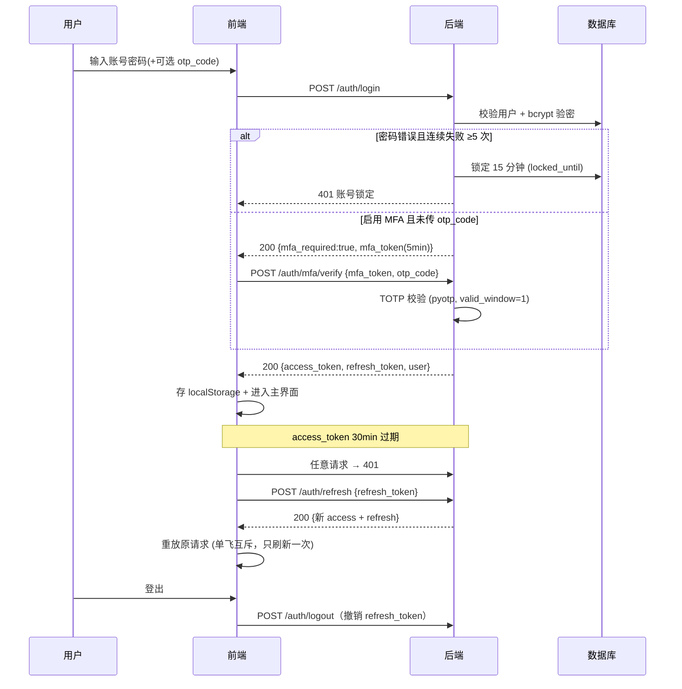
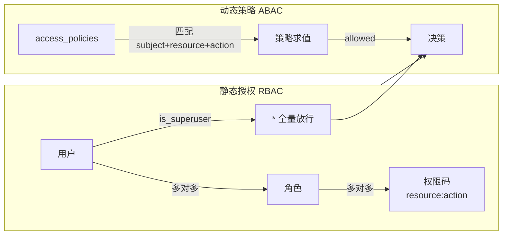
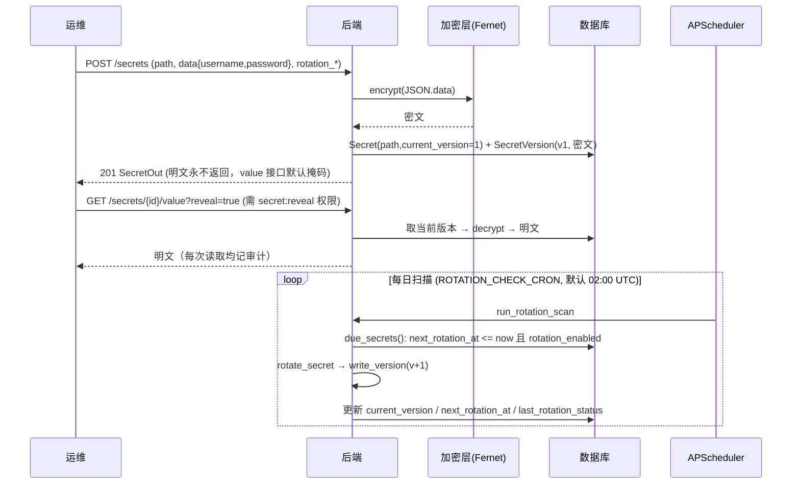

# 4A 平台架构设计

## 1. 总体架构

**分层原则**：路由（HTTP 契约与权限声明）→ 服务（业务逻辑与审计埋点）→ 模型（SQLAlchemy）→
存储/加密。服务层是唯一接触 `AuditLog` 与密钥加密的入口，保证"写操作必留痕、密钥必加密"。

## 2. 后端模块职责

| 模块 | 职责 |
|------|------|
| `app/main.py` | FastAPI 入口。lifespan：`init_db()`（建表）→ `seed()`（幂等种子）→ `start_scheduler()`（启动调度器）。挂载 12 个路由（前缀 `/api/v1`）+ CORS + `/healthz` `/readyz` 探针 |
| `app/core/config.py` | pydantic-settings 读取环境变量/`.env`，集中管理全部配置（令牌有效期、密码策略、主密钥、CORS、调度 CRON 等） |
| `app/core/security.py` | 密码哈希（bcrypt rounds=12）、密码强度校验（≥12 位 + 大小写 + 数字 + 特殊字符）、JWT 签发/校验（access 30min / refresh 7d / mfa 5min 三种 token）、TOTP 生成与校验 |
| `app/core/crypto.py` | 密码托管加密层：Fernet（AES-128-CBC + HMAC-SHA256）。生产必须配置 `VAULT_MASTER_KEY`，未配置且 `ENVIRONMENT=production` 时拒绝启动（fail 模式） |
| `app/models/` | 11 张表：users、groups、organizations、roles、permissions、applications、access_policies、secrets、secret_versions、audit_logs、refresh_tokens |
| `app/api/routers/` | 12 个路由：`auth`（登录/MFA/刷新/登出/me/改密）、`users`、`groups`、`orgs`（含树）、`apps`（含 launch）、`roles`、`permissions`、`policies`（含 evaluate）、`audit`（含 stats）、`secrets`（含 value/versions/rotate）、`rotations`（due/run）、`dashboard`（stats） |
| `app/services/rbac_service.py` | 权限解析：加载用户直属角色权限 → 取并集；超管（`is_superuser`）返回 `["*"]` 全量放行 |
| `app/services/policy_service.py` | ABAC 策略求值：按主体（用户/组/角色/组织）+ 资源 + 动作匹配策略，支持 ALLOW/DENY 与优先级 |
| `app/services/audit_service.py` | 统一审计写入：类别/动作/结果/操作人/IP/UA/目标/详情/request_id |
| `app/services/secret_service.py` | 密钥写入：JSON 序列化 → Fernet 加密 → 追加不可变版本；`write_version` 同时推进 `current_version` 并计算 `next_rotation_at` |
| `app/services/rotation_service.py` | 轮换逻辑：`due_secrets`（到期扫描：`next_rotation_at <= now` 且启用轮换）→ `rotate_secret`（生成新版本，记录成功/失败与错误信息） |
| `app/services/scheduler.py` | APScheduler 后台定时任务，按 `ROTATION_CHECK_CRON`（默认 `0 2 * * *` UTC）触发轮换扫描，`max_instances=1` 防重入 |
| `app/seed.py` | 幂等初始化：27 个权限码 → 5 个内置角色 → 示例组织/组 → 引导管理员 → 5 个示例应用 → 1 个示例密钥 → 1 条示例策略 |

## 3. 前端模块职责

| 模块 | 职责 |
|------|------|
| `src/api/client.ts` | axios 实例。请求拦截器自动附加 `Bearer`；响应拦截器 401 时**单飞（in-flight）刷新 token** 并重放原请求，刷新失败则清令牌跳登录页（`/auth/` 接口自身除外，避免死循环） |
| `src/api/endpoints.ts` | 按域封装全部请求函数（authApi/userApi/…/dashboardApi），与 `docs/api-contract.md` 一一对应 |
| `src/contexts/AuthContext.tsx` | 登录态管理：`me`（用户+权限+角色+组）、`can(permission)` 权限判断（超管恒真）、token 存取（localStorage：`4a_access_token` / `4a_refresh_token`） |
| `src/components/ProtectedRoute.tsx` | 路由守卫：未登录重定向 `/login`；`PermissionGate` 按权限码控制页面级访问 |
| `src/layouts/AppLayout.tsx` | 主界面：侧边菜单**按当前用户权限动态渲染**（无权限的入口不显示） |
| `src/pages/` | 12 个页面：登录、仪表盘、个人中心（改密/MFA 绑定）、用户/组/组织、应用、角色、策略、审计、密钥、轮换 |

## 4. 数据模型

**关键约束**：
- `secrets.path` 唯一 → 同一目标设备/账号只允许一条托管记录（重复创建返回 409）。
- `secret_versions` 不可变追加，`version` 单调递增 → 轮换/更新天然留痕，支持回溯历史密码。
- `roles.is_builtin` 内置角色禁止删除/改码，保证 `super-admin` 兜底权限始终存在。

## 5. 认证流程

**令牌设计**：access（30min，内存/会话态）与 refresh（7d，可撤销，存 `refresh_tokens` 表）分离；
MFA 中间态用 5min 短时效 `mfa_token`。登出即撤销 refresh token，服务端换绑/改密会触发全量令牌失效。

## 6. 授权模型（RBAC + ABAC）

- **RBAC 主路径**：`GET /auth/me` 返回当前用户全部权限码并集（超管返回全部 27 个码，`*` 不下发，
  前端 `can()` 遇 `is_superuser` 直接放行）。列表/菜单/按钮级控制全部由权限码驱动。
- **ABAC 扩展**：`POST /policies/evaluate` 按「主体类型+主体 ID / 资源类型+资源 ID / 动作」匹配策略，
  按 `priority` 合并 ALLOW/DENY，支持 `conditions` 条件JSON 与 `expires_at` 时效，用于动态访问预判
  （如：仅当用户属于运维组且动作属于策略允许集合时才放行）。
- 内置 5 角色：`super-admin`(全量)、`iam-admin`(身份管理)、`security-auditor`(审计)、
  `secret-admin`(密码托管)、`readonly`(只读)。

## 7. 密码托管与轮换

**安全要点**：
- 明文只在 `secret:reveal` 权限校验通过后返回，且路径常显掩码（`P@******3`）。
- `VAULT_MASTER_KEY` 生产必配：缺失时 `ENVIRONMENT=production` 直接拒绝启动，防止用弱派生密钥托管密码。
- 每次读取/轮换/更新都会写入 `audit_logs`（category=`vault`），失败轮换记录 `last_rotation_error`。

## 8. 审计设计

所有写操作（账号/授权/应用/密钥/轮换）与认证事件通过 `audit_service.record()` 统一落库：

- **五类**：`auth`（登录/登出/MFA/改密）、`account`（账号增删改）、`authz`（角色/策略变更）、`admin`（系统管理）、`vault`（密钥托管操作）。
- **字段**：时间、类别、动作、结果（success/failure）、操作人（id+用户名）、IP（识别 `X-Forwarded-For`）、
  UA、目标（类型/ID/名称）、消息、JSON 详情、`x-request-id`。
- **查询**：`GET /audits` 支持类别/结果/操作人/动作/时间段过滤 + 分页；`GET /audits/stats` 返回最近 N 天（默认 7）按日分布与成功/失败占比，供仪表盘直出。

## 9. 安全设计清单

| 项目 | 实现 |
|------|------|
| 口令存储 | bcrypt（cost=12） |
| 口令策略 | ≥12 位，含大小写/数字/特殊字符（`PASSWORD_MIN_LENGTH` 可配） |
| 登录防爆破 | 连续失败 5 次锁定 15 分钟（`MAX_FAILED_LOGINS` / `LOCKOUT_MINUTES`） |
| 会话 | JWT 双 token + 服务端 refresh 撤销；MFA 短时效中间态 |
| 双因素 | TOTP（pyotp），登录接口可选 `otp_code` 或走 `mfa/verify` |
| 托管密钥 | Fernet（AES-128-CBC + HMAC）静态加密；主密钥独立于数据库 |
| 传输 | 生产强制 HTTPS（Nginx TLS，见部署文档） |
| CORS | 默认仅放行本地前端源（`CORS_ORIGINS` 可配） |
| 审计 | 全量写操作留痕，失败事件也记录（`result=failure`） |
| 最小权限 | 前端按权限码渲染入口 + 后端路由级鉴权双重控制 |